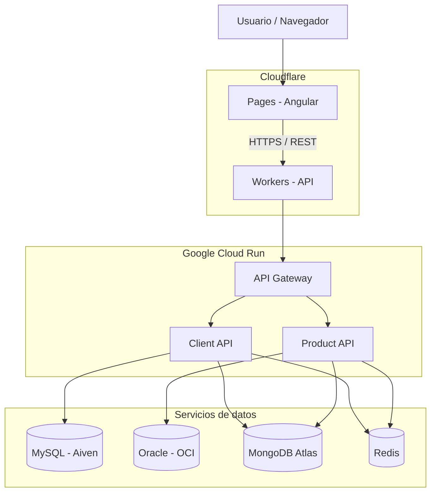

# Arquitectura del proyecto

## Descripción general

Este proyecto es una aplicación web basada en microservicios, desarrollada principalmente con Angular y Spring Boot.

El frontend se comunica con los servicios backend a través de un API Gateway, que centraliza el acceso a las APIs. Cada microservicio tiene una responsabilidad específica y utiliza las tecnologías de persistencia que necesita.

La aplicación utiliza servicios de diferentes proveedores cloud para el alojamiento, las bases de datos y la infraestructura.

## Arquitectura general

## Componentes principales

| Componente | Tecnología | Descripción |
|---|---|---|
| Web Client | Angular | Interfaz web de la aplicación. |
| API Gateway | Spring Cloud Gateway | Punto de entrada que dirige las solicitudes a los microservicios. |
| Client API | Spring Boot | Gestión de clientes y sus datos. |
| Product API | Spring Boot | Gestión de productos. |
| Order API | Spring Boot | Servicio de órdenes que forma parte del proyecto, todavía no desplegado en Cloud Run. |

## Bases de datos y caché

El proyecto utiliza diferentes tecnologías de almacenamiento según las necesidades de los servicios.

- **MySQL (Aiven):** almacenamiento de información de clientes.
- **Oracle Database (OCI):** almacenamiento de información de productos.
- **MongoDB Atlas:** almacenamiento de registros de auditoría.
- **Redis:** almacenamiento en caché para reducir consultas repetidas.
- **H2:** base de datos utilizada en entornos locales de desarrollo.

## Infraestructura y despliegue

La aplicación utiliza una arquitectura distribuida entre diferentes plataformas:

- **Cloudflare Pages:** publicación del frontend Angular en `app.lupatek.com`.
- **Cloudflare Workers:** intermediario para las solicitudes recibidas en `api.lupatek.com`.
- **Google Cloud Run:** ejecución del API Gateway y los microservicios Client API y Product API.
- **Oracle Cloud Infrastructure:** alojamiento de la base de datos Oracle.
- **MongoDB Atlas y Aiven:** servicios administrados de bases de datos.

El código fuente está organizado en un monorepositorio de GitHub. Los despliegues se realizan mediante integraciones con GitHub y los servicios de compilación de cada plataforma.

Para el frontend se utiliza Cloudflare Pages, configurado para ejecutar nuevas compilaciones cuando existen cambios en la carpeta `web-client`.

## Comunicación entre componentes

El usuario accede a la aplicación desde el navegador mediante el dominio `app.lupatek.com`.

Angular realiza solicitudes HTTP al dominio `api.lupatek.com`, que utiliza Cloudflare Workers para dirigirlas al API Gateway alojado en Google Cloud Run.

El Gateway identifica la ruta solicitada y la redirige al microservicio correspondiente. Cada servicio procesa la operación y accede a sus bases de datos o sistemas de caché según sea necesario.

Esta organización permite mantener el frontend separado del backend y desarrollar los servicios de forma independiente.

## Seguridad

La comunicación pública utiliza HTTPS y el API Gateway dispone de una configuración CORS para permitir solicitudes desde el frontend.

Las credenciales de conexión y otros valores sensibles se gestionan mediante variables de entorno y servicios de gestión de secretos.

Los microservicios que requieren acceso a bases de datos externas utilizan una configuración de red en Google Cloud con salida controlada mediante VPC y Cloud NAT.

La autenticación y autorización de usuarios, así como la protección adicional de los endpoints públicos, son aspectos pendientes de fortalecer.

## Consideraciones arquitectónicas

Se eligió una arquitectura de microservicios para separar las responsabilidades de la aplicación y permitir el despliegue independiente de sus componentes.

El API Gateway proporciona un punto de entrada común, mientras que el uso de diferentes tecnologías de persistencia permite adaptar el almacenamiento a las necesidades de cada servicio.

La infraestructura combina Cloudflare, Google Cloud y proveedores externos de bases de datos, aprovechando los servicios administrados disponibles.

Como siguientes mejoras se contempla fortalecer la seguridad entre servicios, incorporar monitoreo centralizado y mejorar la automatización de los despliegues.